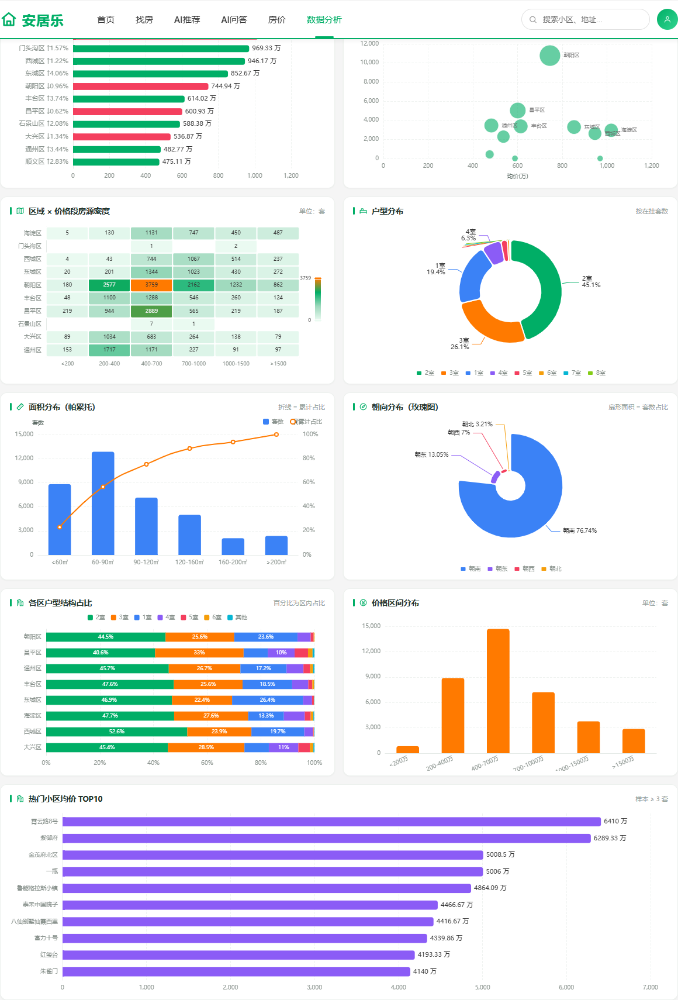
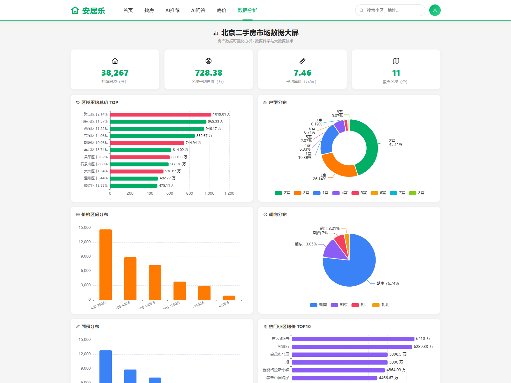
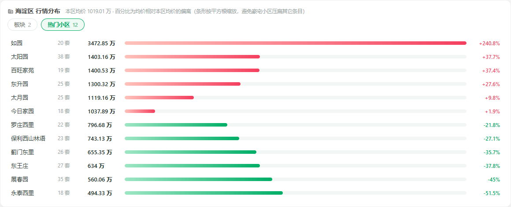

# 🏠 基于 RAG 的房产智能问答推荐系统

[](https://github.com/ljc67899/house-rag-system/actions/workflows/ci.yml)
[](LICENSE)
[](https://www.python.org/)

> 把 RAG、多智能体与协同过滤接到真实房源数据上的智能问答推荐系统
>
> 技术栈：FastAPI · LangChain · LangGraph · ChromaDB · LLM · MySQL · Vue3（CDN，无构建）

一个在传统房产信息管理系统之上叠加了检索增强生成能力的项目：把「表单筛选房源」升级为「用自然语言找房、问政策、看行情」，并在同一套后端里完成问答、推荐、估价、走势预测与 AI 看房报告。

---

## 一、功能模块

| # | 模块 | 说明 | 定位 |
|:--:|---|---|:--:|
| ① | 房源浏览展示 | 列表、热门、最新 | 基础 |
| ② | 房源搜索筛选 | 关键词 / 区域 / 户型 / 价格多条件 | 基础 |
| ③ | 房源详情查看 | 详细信息、配套设施、交通周边 | 基础 |
| ④ | AI 智能问答（RAG） | 双路召回 + 库内 RRF 混合检索 + 引用溯源 | 创新 |
| ⑤ | 知识库文档管理 | 上传、解析、切分、向量化 | 创新 |
| ⑥ | 房源向量化索引 | 结构化房源数据向量化，支持语义检索 | 创新 |
| ⑦ | 智能推荐系统 | 协同过滤 + 内容匹配 + 用户画像 | 进阶 |
| ⑧ | 房源对比 | 最多 4 套横向对比 | 进阶 |
| ⑨ | 房源收藏 | 收藏 / 取消 / 列表管理 | 进阶 |
| ⑩ | 评论评分 | 星级评分、平均分统计、楼中楼回复 | 进阶 |
| ⑪ | 浏览历史 | 自动记录，上限 50 条 | 进阶 |
| ⑫ | 租金智能估算 | 多因素加权，返回区间与置信度 | 创新 |
| ⑬ | 周边配套地图 | 高德 POI 6 类设施 + 直线距离 + 地图联动 | 创新 |
| ⑭ | 站内消息通知 | 回复提醒、红点角标、已读状态、点击直达 | 进阶 |
| ⑮ | 多智能体问答 | Supervisor + 4 个专家 Agent 动态调度 | 创新 |
| ⑯ | AI 看房报告 | 估价 + 分位 + 走势 + POI + 可选图片理解，六段式报告 | 创新 |

> 基础辅助能力（不计入核心模块）：注册登录、页面导航、数据统计、后台管理。

### 界面截图

| 首页 | 数据大屏 |
|---|---|
|  |  |

| 区域行情 | 板块走势 |
|---|---|
|  |  |

检索效果与消融对比见 `docs/eval_report_v8.md`。

---

## 二、系统架构

```
┌──────────────────────────────────────────────────────────────┐
│                  前端 Vue3 + fetch（无构建）                   │
│ 首页 | 房源 | 推荐 | 对比 | 收藏 | AI问答 | 房价走势 | 数据分析  │
│ 详情页：AI看房报告 · 评论楼中楼 · 周边地图                      │
│ 导航栏：消息通知 · 管理后台（/admin，仅管理员可见）             │
└───────────────────────────┬──────────────────────────────────┘
                            │ HTTP / SSE
┌───────────────────────────▼──────────────────────────────────┐
│                      FastAPI 后端                             │
│  路由层  house / chat / knowledge / analysis / admin / user   │
│  服务层  HouseService · CommentService · NotificationService   │
│          TrendService · EstimateService · ViewingReportService │
│  ┌──────────────────────────────────────────────────────────┐ │
│  │        多智能体编排层（LangGraph + LangChain）            │ │
│  │  Supervisor（规则优先 + LLM 兜底）                        │ │
│  │    ├─ house_search → SQL 结构化过滤                       │ │
│  │    ├─ knowledge    → Chroma 政策知识库                    │ │
│  │    ├─ analytics    → LSTM 走势 + 区域行情分位             │ │
│  │    └─ retrieve     → 房源库 稠密 + BM25 的 RRF 融合       │ │
│  │  generate 汇总生成 + sources | MemorySaver 多轮记忆        │ │
│  └──────────────────────────────────────────────────────────┘ │
└──────────────┬────────────────────────────┬───────────────────┘
               │                            │
        ┌──────▼──────┐              ┌──────▼──────┐
        │   MySQL     │              │  ChromaDB   │
        │ 业务/消息/趋势│              │  向量数据库  │
        └─────────────┘              └─────────────┘
```

---

## 三、RAG 问答链路

### 3.1 LangGraph 状态图

问答不是线性代码，而是编译成一张状态图（`app/services/rag_graph.py`），共 8 个节点、3 处条件边：

```
                       ┌──────────────────┐
           START ─────>│  analyze_intent  │  寒暄 / 空问题直接跳过检索
                       └────────┬─────────┘
                    ┌───────────┴────────────┐
           需要检索 │                        │ 寒暄闲聊
                    ▼                        │
           ┌──────────────────┐              │
           │    supervisor    │ 规则优先 + LLM 兜底
           └────────┬─────────┘              │
       ┌────────────┼──────────────┐         │
       ▼            ▼              ▼         │
┌────────────┐┌──────────┐┌─────────────┐   │
│house_search││analytics ││rewrite_query│   │
│  SQL 过滤  ││LSTM+分位 ││  追问改写   │   │
└─────┬──────┘└────┬─────┘└──────┬──────┘   │
      │            │      ┌──────┴─────┐    │
      │            │      ▼            ▼    │
      │            │ ┌──────────┐ ┌────────┐│
      │            │ │knowledge │ │retrieve││
      │            │ │Chroma 文档│ │双路召回││
      │            │ └────┬─────┘ └───┬────┘│
      └────────────┴──────┴───────────┴─────┘
                              ▼
                     ┌──────────────────┐
                     │     generate     │ ChatOpenAI 流式生成
                     └────────┬─────────┘
                              ▼
                            END
```

| 机制 | 实现 | 作用 |
|---|---|---|
| 条件路由 | `add_conditional_edges`（3 处） | 寒暄跳过检索；Supervisor 选专家；知识/混合问题选 `knowledge` 或 `retrieve` |
| 追问改写 | `rewrite_query` + LLM | 补全省略句，避免「第一套的户型」跑偏 |
| 多轮记忆 | `MemorySaver` + `add_messages` | 按 `thread_id`（即 conversation_id）隔离会话 |
| 流式输出 | `stream_writer` + `stream_mode=["custom","values"]` | 先推 `agent_step`，再推 sources，最后逐 token 推 delta |
| 节点职责 | 8 节点单一职责 | 可独立单测 |

**为什么需要 `rewrite_query`**：向量检索只看当前这句话，不看历史。「第一套的户型是多少」若直接检索，会召回一批"含户型描述"但与上一轮推荐无关的房源。

| | 上一轮第 1 套 | 追问后被回答的房源 |
|---|---|---|
| 改造前 | 首邑溪谷 272 万 2室1厅 | 首座御园一区二期 405 万 3室2厅（无关） |
| 改造后 | 首邑溪谷 272 万 2室1厅 | 首邑溪谷 2室1厅（正确） |

首轮无历史时 `rewrite_query` 直接返回原问题，不产生额外 LLM 开销。

### 3.2 Supervisor 与专家 Agent

| 角色 | 工具 | 解决什么 |
|---|---|---|
| **Supervisor** | 关键词 + 实体规则；规则失效时 LLM 四选一 | 决定谁接手，避免所有问题都过一遍向量库 |
| **house_search** | `HouseService.get_house_list`（SQL） | 硬条件（「朝阳区 600 万以内两居」）向量检索不敏感，改精确过滤 |
| **knowledge** | `get_doc_store()`（Chroma 知识库） | 政策 / 税费 / 过户流程不该混进房源结果 |
| **analytics** | `TrendService`（LSTM）+ `MarketStatsService`（单价分位、总价中位数） | 「会涨吗 / 值不值」需要模型算，不是让 LLM 编 |
| **retrieve** | 房源库（稠密 + BM25 RRF）+ 知识库（单路向量） | 混合问题与兜底 |
| **generate** | 各专家产出的上下文 | 统一生成回答与 sources，流式协议不变 |

刻意的取舍：

- **先规则后模型**：规则能判定的不额外花一次 LLM 调用，成本与延迟可控。
- **专家不共享上下文**：每个 Agent 只返回结构化结果，由 generate 拼装，避免互相污染。
- **失败只降级局部**：某个专家异常只把自己结果置空；路由阶段出错回退 `retrieve`。
- **流式可观测**：Supervisor 决策通过 `agent_step` 推送，前端显示「智能体调度：行情分析」，路由过程可以直接观察。

实测路由：

| 用户问题 | 命中专家 | 判定依据 |
|---|---|---|
| 朝阳区 600 万以内的两居推荐几套 | house_search | 区域 + 预算 + 户型 |
| 北京购房资格和契税怎么算 | knowledge | 政策 / 知识关键词 |
| 海淀区未来半年房价会涨吗 | analytics | 行情 / 预测关键词 |

### 3.3 检索：跨库双路 + 库内混合

两个「双」不是一回事，代码里分开实现。

**第一层 · 跨库双路召回**（`retrieve` 节点）

同时检索**房源数据**（结构化）与**知识文档**（政策攻略），两路都走 LangChain `VectorStore` 接口（`HouseVectorStore`），复用 ChromaDB 已建好的向量。

> 这两路候选永不重叠（同一套房源不会出现在知识库），所以只做并列、不做融合——在不重叠候选集上做 RRF 或加权融合，数学上是空操作。真正需要融合的是下一层。

**第二层 · 房源库内混合召回**（`_house_hybrid_recall`）

| 路 | 实现 | 擅长 |
|---|---|---|
| 稠密 | Chroma 向量（bge 嵌入），阈值 0.5 | 语义近似：「预算不多想买个两居」 |
| 稀疏 | 内存 BM25（`app/services/sparse_index.py`） | 字面精确：「南十里居」「东风家园」 |

两条链路各召回 50 条（`RAG_DENSE_RECALL_K` / `RAG_SPARSE_RECALL_K`），候选池刻意远大于最终取数，名次类融合才有区分度。

**融合用的是加权 RRF**（k=60）：

```
score(d) = Σ w_i / (60 + rank_i(d))
```

字面型查询（含小区名、地铁站等）会把稀疏路权重从 1.0 提到 **1.6**，否则精确匹配的第一名会被稠密路的第 5 名「投票」稀释掉。选 RRF 而不是加权平均的原因：稠密路给 cosine（0~1），稀疏路给 BM25（无上界），加权平均要先调归一化系数；RRF 只看名次，天然抹平尺度差异。

**融合后还要过两道工序**：

| 工序 | 做法 | 解决什么 |
|---|---|---|
| cross-encoder 精排 | `bge-reranker-base` 对融合后的 Top-20 逐条打相关性分 | 召回只看「像不像」，精排看「答没答到点上」 |
| 小区级去重 | 同一小区优先只保留最高分一条 | 避免 Top5 全是同一个小区，失去可比性 |

> 精排模型懒加载、失败返回 `None` 静默退回融合排序；CPU 上 20 条约 200~400ms，因此只对融合后的 `RAG_FUSE_TOP_N` 做，不全量精排。整段上下文最后按 `RAG_CONTEXT_TOKEN_BUDGET`（默认 3000 token）裁剪。

实现细节：

- 中文用**字符 bigram** 切词，不引入 jieba；单字降权 0.3，避免「的」「区」刷分
- 按 `to_search_doc()` 的 `字段：值` 结构做**字段加权**：小区 2.5、区域 1.8、标题 1.6，描述类压低
- BM25 索引按向量库规模做版本缓存，重建后自动失效
- 任一路异常自动降级为另一路单跑

`sources` 每条结果带 `retrieval`（`dense+sparse` / `dense` / `sparse`）与 `rrf_score`，便于排查召回来源。

### 3.4 索引策略

库内 38,266 条房源、4,900 个小区、13,355 个「小区 × 户型」组合。索引规则：

| 项目 | 说明 |
|---|---|
| 抽样 | 按「小区 × 户型」组合**各保底 1 条**，余量按 id 升序补齐 |
| 规模 | 默认上限 `RAG_HOUSE_INDEX_LIMIT=40000`，达到库内总数即**全量索引** |
| 写入 | **先写新向量，成功后删旧向量**，库中始终只有一份 |
| 触发 | 前端「重建索引」→ `POST /api/knowledge/index-houses`，或 `scripts/rebuild_vector_store.py` |

为什么不是「每区取前 N 条」——这条路走过三次，每步都被数据打回来：

1. `limit(1000)` 按主键取数，实测 1000 条**全属朝阳区**，其余 11 区一条没有。
2. 改成按区域等量抽样，覆盖全了，但只覆盖 288 个小区、平均每小区 3 套，检索几乎没有竞争，评测集上 recall@k 全部饱和到 1.000——分数漂亮，测不出排序能力。
3. 扩到 4000 后反而有小区整片消失（安苑里 / 双龙南里 / 安慧里三区），因为房源按街道成团落库，某些小区全部落在配额之外。

现在按「小区 × 户型」保底保证覆盖完整，规模放到全量：库里 38,266 条若只索引 16,000 条，会有 22,266 条（58.2%）永远检索不到——用户问「双龙南里 两居」只给 1 套（实际 5 套），这类**语料缺失任何精排都救不回来**。bge-small 嵌全量不成问题，HNSW 查询是对数级，检索时延基本不变。

> 另一个坑是**追加写入**：重复调用把同一批房源反复堆进库，向量数 841 → 1841 → 2841 递增，检索结果重复。现在接口是「重建」语义，调多少次库中都只有一份。

### 3.5 数据版本校验（启动自检）

向量库是派生数据，必须与 DB 一致：

```
数据版本 = 房源总数 - 最大id - 最新updated_at
```

三者覆盖全部变更：新增改条数与最大 id，修改改 `updated_at`，删除改条数。

| 情况 | 行为 |
|---|---|
| 版本一致且库非空 | 跳过，秒级启动 |
| 版本不一致 | 自动重建并更新版本号 |
| 向量库为空 | 自动建索引 |
| 无版本号（升级后首启） | 按当前数据重建一次 |

版本号写入 `data/vector_db/index_version.json`。**原因**：ChromaDB 1.x 不允许用 `modify()` 改 collection metadata（会触发「distance function 不可变更」校验失败），所以落 JSON。

### 3.6 LangChain 集成点

| 原实现 | 现实现 |
|---|---|
| `openai.AsyncOpenAI` 手写 chat.completions | `langchain_openai.ChatOpenAI` |
| f-string 拼 Prompt | `ChatPromptTemplate` + LCEL（`prompt \| llm \| parser`） |
| 手写定长切分 | `RecursiveCharacterTextSplitter`（中文标点分隔） |
| 直接调 chromadb SDK | 自定义 `HouseVectorStore(VectorStore)` + `HouseEmbeddings(Embeddings)` |
| 手写 if/else 编排 + dict 存历史 | LangGraph `StateGraph` + `MemorySaver` |

> 适配层刻意复用已有向量库，换技术栈后不必重建索引（维度与归一化方式保持一致）。

**向量嵌入**：默认 DashScope `text-embedding-v2`（免本地模型、速度快）；可切本地 `BAAI/bge-small-zh-v1.5`（离线可用）。

### 3.7 检索评测（可复现）

「感觉检索变好了」不算结论，所以配了一套标注集与评测脚本，每次改召回/融合参数都能重跑对比。

| 资产 | 内容 |
|---|---|
| `data/eval/retrieval_set.json` | 54 题检索标注集：字面型 15 / 混合型 22 / 语义型 17 |
| `data/eval/extraction_set.json` | 27 题条件抽取集，覆盖 58 个字段 |
| `scripts/eval_rag.py` | 评测入口，输出 Markdown 报告 |
| `docs/eval_report_v8.md` | 最新一版报告（共 8 版，保留迭代轨迹） |

```bash
# 纯检索评测（不调 LLM，可离线复跑）
python scripts/eval_rag.py --top-k 5 --out docs/eval_report.md

# 加上路由评测（会调用 LLM 判断 Supervisor 是否选对专家，产生费用）
python scripts/eval_rag.py --routing
```

指标不只是 recall，还包括：`strict@1`、约束满足@1、覆盖@k（按库内合格集归一）、合格精度@k、MRR、nDCG@5、小区精度@5、**假放宽**（把用户条件偷偷放宽后硬凑结果的次数）、零覆盖题、distinct@5。

同一套题上做五档消融，证明每个环节都有贡献：

| 档位 | 说明 |
|---|---|
| `dense` | 只用向量召回 |
| `sparse` | 只用 BM25 |
| `hybrid_nofilter` | 双路 + RRF，不做硬条件过滤 |
| `hybrid_no_div` | 双路 + RRF + 精排，不做小区去重 |
| `hybrid` | 完整链路 |

最新结果（`docs/eval_report_v8.md`）：`hybrid` 档 `strict@1 = 1.000`、覆盖@k `0.953`、合格精度@k `0.892`、假放宽 `0.000`；条件抽取 27/27 全对，字段准确率 100%。评测里还写了 4 条绝对阈值作为**发布门禁**，低于阈值视为退化。

> 诚实说明：项目**没有单元测试**（`requirements.txt` 里的 pytest 是预留依赖），CI 只做语法编译、密钥扫描和配置键一致性校验。评测脚本依赖 MySQL + 向量库 + 嵌入模型，不能离线跑，因此没有放进 CI。

---

## 四、AI 看房报告

详情页一键生成，不是重新查一遍，而是**四类事实分别取证、最后由 LLM 汇总**：

```
房源事实（house_info）
      ├─ EstimateService    → 估价区间 + 特征拆解
      ├─ MarketStatsService → 区域单价中位数、P25/P75、本房分位
      ├─ TrendService       → LSTM 未来 6 个月走势与涨跌幅
      ├─ ExternalGeoService → 高德 POI：地铁/学校/医院/购物 最近 2 个 + 距离
      └─ 视觉模型（可选）    → 实拍图理解（LLM_VISION_MODEL，未配置则跳过）
                    ▼
          ViewingReportService 汇总 Prompt
                    ▼
六段式 Markdown：一句话结论 / 房源与价格诊断 / 周边与通勤
               / 价格走势判断 / 议价与风险提示 / 建议下一步
```

| 设计点 | 做法 |
|---|---|
| 数字可核验 | 价格、分位、涨跌幅、距离全部来自系统工具，禁止 LLM 编造 |
| 工具失败不拖垮 | 每个工具独立 try/except，缺失小节如实写「暂无数据」 |
| LLM 不可用也能出 | 输出过短或调用失败时回退模板（`degraded=true`），接口永远有内容 |
| 控成本 | 结果内存缓存 10 分钟，`?refresh=true` 强制重算 |
| 多模态可选 | 配置 `LLM_VISION_MODEL`（如 `qwen-vl-plus`）才做图片理解 |

接口：`GET /api/analysis/viewing-report/{house_id}?refresh=false`

---

## 五、智能推荐（协同过滤 + 画像）

两条链路，用途不同：

| 链路 | 接口 | 算法 | 用途 |
|---|---|---|---|
| 简易版 | `GET /api/houses/recommendations` | 热度 20 + 收藏 30 + 浏览 20 + 随机 0~15 | 兜底，v2 异常时使用 |
| 正式版 | `GET /api/analysis/recommend/v2` | 行为矩阵 → ItemCF + UserCF + 内容匹配 | 推荐页（含画像与理由） |

代码：`collab_service.py`（正式版）、`recommend_service.py`（简易版）。

**1. 行为矩阵**

| 行为 | 来源 | 权重 |
|---|---|---|
| 收藏 | `house_recommend.score = -1` | 3 |
| 对比 | `house_compare`（按 `user_name` 反查 id） | 2 |
| 评论 | `house_comment` | 评分 1~5 原值 |
| 浏览 | `browse_history` | 1 |

同一用户对同一房源多次操作**累加**，得到稀疏矩阵 `M[user][house]`。评论超 8,000 条后按 `id % 50 == 0` 抽样，避免同用户交互对爆炸（只影响相似度绝对量级，不影响排序）。

**2. ItemCF**

```
cooc(a,b) = 同时操作过 a 和 b 的用户数
sim(a,b)  = cooc(a,b) / sqrt(|U(a)| × |U(b)|)      # 余弦 + 流行度惩罚
score(候选) = Σ_{h ∈ 用户交互过} M[user][h] × sim(h, 候选)
```

只遍历「同一用户交互过的房源对」，复杂度 `O(Σ_u C(n_u,2))`，不做 `O(N²)` 全量配对。

**3. 内容匹配修正**

```
score *= 0.9 + 0.1 × content_match
content_match = 0.5×偏好区域 + 0.3×价格区间 + 0.2×偏好朝向
```

系数保守（0.9~1.0）：行为相似 ≠ 需求相似，内容只做修正，主信号仍是行为。

**4. UserCF 长尾补充**

取余弦 Top-8 邻居：`score += sim(user, neighbor) × M[neighbor][house] × 0.8`，0.8 为「邻居证据折扣」。

**5. 用户画像**：`preferred_regions`(Top-3)、`preferred_direction`(Top-2)、`preferred_rooms`(面积 `round(面积/45)+1` 粗估后 Top-2)、`price_range`、`behavior_count`、`profile_label`（核心城区/刚需/改善/高端）、`top_interactions`(Top-5)。

**6. 冷启动与降级**：无行为 → `cold_start`，按 `publish_date` 倒序取 `limit×3`，固定种子 `random.Random(20260825)` 抽样（顺序可复现）；v2 异常 → 前端回退简易版；管理员/游客统一 `user_id=0`，避免 `admin` 与 `user_info` 两套 ID 串号。

**7. 性能取舍**：只取 13 个轻量列 → 按 id 分批（每批 4,000）→ 仅算共现对 → 最后取 Top-N 完整记录 → 不缓存（行为实时变化）。3.8 万房源下单次请求百毫秒级。

---

## 六、租金估算

以同区域真实单价为基准做多因素连乘修正，返回区间与置信度。5 个因子：

| 因子 | 处理 |
|---|---|
| 面积 | 小户型溢价、大户型递减 |
| 装修 | 毛坯 / 简装 / 精装 / 豪装 |
| 朝向 | 南北通透 > 朝南 > 其他 > 朝北 |
| 楼层 | 高层 > 中层 > 顶层 > 低层 |
| 户型 | 一居室溢价、大户型优惠 |

置信度不是简单按样本数线性加分，而是**同时惩罚样本不足与价格离散度**：

```
confidence = 0.95
           - min(0.35, dispersion × 0.8)        # 同区域样本价格越散，越不可信
           - (1 - min(1, n / 300)) × 0.15       # 样本数不足 300 按比例扣分
confidence = clamp(confidence, 0.4, 0.92)
```

无同区域样本时直接返回 `0.3`，避免「样本为 0 却报 95% 置信度」这种假精确。

---

## 七、周边配套地图（高德 POI）

详情页左地图、右分类列表（名称 + 直线距离），列表与地图双向联动。

接口：`GET /api/houses/{house_id}/surroundings?radius=1500`

| key | 中文 | 高德 types |
|---|---|---|
| traffic | 交通 | `150500｜150700`（地铁 + 公交） |
| school | 学校 | `141200｜141201｜141202｜141203｜141204` |
| food | 餐饮 | `050000` |
| shop | 购物 | `060000` |
| hospital | 医院 | `090100` |
| bank | 银行 | `160100` |

每次 `/v3/place/around` 取 `offset=6`、`sortrule=distance`、`extensions=base`，每类最近 6 条。

**缓存与并发（重点）**

- 缓存 key = `(经度 3 位, 纬度 3 位, 分类, radius)`，TTL 1 天，同小区多套房复用
- `ThreadPoolExecutor(max_workers=3)`：个人 key 并发敏感，6 并发会返回 `10021 CUQPS_HAS_EXCEEDED_THE_LIMIT`，实测 3 并发稳定
- 单类失败 `sleep(0.4)` 后重试一次
- **失败与空结果分治**：`_around()` 失败返回 `None`（不写缓存），确认没有才缓存 `[]`
- 实测：冷缓存 ~2.5s，命中 ~0.19s

**前端地图要点**

1. **先建图后取数**：进详情页立即 `ensureNearbyMap()`，切片与请求并行，`map.on('complete')` 才撤遮罩（5s 兜底）
2. **干净底图**：`features: ['bg','road','building']` 关闭自带 POI 图标文字
3. **分类视觉**：23px 圆形徽标，颜色 + 汉字（交·蓝 / 学·紫 / 餐·橙 / 购·青 / 医·红 / 银·金）
4. **房源锚点**：0 尺寸 `.dp-house-anchor` 定位经纬度，`.dp-house-dot` 用 `translate(-50%,-50%)` 钉点，不依赖像素 offset 猜偏移
5. **视野自适应**：切换分类后 `setFitView(房源 + 设施点, maxZoom=16)`
6. **双向联动**：列表点击 / 地图点击都走 `focusNearby()`
7. **降级**：无坐标 → 「该房源暂无坐标」；高德不可用 → 空分类；AMap 未加载 → 200ms 轮询，列表不受影响

---

## 八、鉴权与后台一致性

采用 **RBAC0**：角色绑定权限点，接口按权限点校验，而不是在代码里到处写 `if role == 'admin'`。

| 环节 | 做法 |
|---|---|
| 统一登录 | `POST /api/user/login` 先查 `admin` 再查 `user_info`，返回 `role` |
| 权限模型 | 角色 `admin` / `user` 映射到 9 个权限点，映射存库 + 进程内缓存 |
| 接口校验 | `Depends(require_permission("house:create"))`：取 Token 的 `role` → 查权限码 → 缺失返回 403 |
| 写接口 | `POST/PUT/DELETE /api/houses` 分别挂 `house:create` / `house:update` / `house:delete` |
| 凭证 | HMAC-SHA256 签名 Token（含 `role`），12 小时有效 |
| 前端展示 | 无对应权限则入口不渲染；刷新时非管理员立即清除管理 Token |

9 个权限点：

| 权限码 | 含义 | admin | user |
|---|---|:--:|:--:|
| `house:read` | 查看房源 | ✅ | ✅ |
| `house:manage` | 进入房源管理后台 | ✅ | — |
| `house:create` | 新增房源 | ✅ | — |
| `house:update` | 修改房源 | ✅ | — |
| `house:delete` | 删除房源 | ✅ | — |
| `user:change-password` | 修改本人密码 | ✅ | ✅ |
| `knowledge:manage` | 文档上传 / 删除、重建索引 | ✅ | — |
| `user:manage` | 用户列表 / 重置密码 / 删除 | ✅ | — |
| `comment:manage` | 评论查看与删除 | ✅ | — |

> 新增权限点只需往 `PERMISSION_DEFINITIONS` 加一行并更新角色映射，不用改各接口的写法。

| 场景 | 结果 |
|---|---|
| 普通用户 `user01` 登录 | `role=user`，导航无「房源管理」 |
| 普通用户 Token 调 `POST /api/houses` | 401 管理员凭证无效或已过期 |
| 管理员 `admin` 登录（同一入口） | `role=admin`，导航出现「房源管理」 |
| 管理员 Token 调 `POST /api/houses` | 201，并同步向量库 |
| 不带 / 篡改 Token | 401 |

> **初始管理员口令不写死**：首次启动 `admin` 表为空时，优先取环境变量 `ADMIN_INIT_PASSWORD`；未配置则用 `secrets.token_urlsafe(12)` 随机生成，**只在启动日志中打印一次**。仓库（含 `.env.example`）里不存在任何可直接登录的默认后台口令。

**修改密码**：`POST /api/user/change-password`，走 `require_login`，按 Token 中 `role` 分别更新 `admin.password_hash` 或 `user_info.password`。校验原密码、新密码 ≥6 位且不同于原密码、前端二次确认；管理员改后强制重登。

**写操作同步向量库**：新增→写入；修改→先删旧再写新（替换而非追加）；删除→删除该房源全部向量。

### 8.1 开源与隐私边界

仓库公开，所以这些边界是刻意划出来的：

| 项 | 现状 |
|---|---|
| 密钥 | `.env` 被 `.gitignore` 排除；高德 JS Key 与安全密钥由后端 `/api/config/map` 下发，源码中不出现 |
| 后台口令 | 无默认口令，取 `ADMIN_INIT_PASSWORD` 或启动时随机生成 |
| 房源数据 | 含 `landlord` / `phone` 列的原始表已移出版本库，公开的是剔除该两列的 `mysql_house_data_public.csv` |
| 演示用户 | 初始化会生成模拟用户，口令统一 `123456`（仅服务于大屏与协同过滤的演示数据），**生产部署应删除** |
| 数据来源 | 见 `data/DATA_SOURCE.md`，数据仅用于学术演示 |
| CI 门禁 | 自动检查 `.env` 未被追踪、源码无硬编码密钥、`.env.example` 的键都能被 `config.py` 识别 |

---

## 九、项目结构

```
house-rag-system/
├── app/
│   ├── api/
│   │   ├── deps.py              # 鉴权依赖（require_login / require_permission）
│   │   └── routes/              # 路由层（挂载在 /api）
│   │       ├── house.py         # 房源/推荐/对比/收藏/评论/估算/周边
│   │       ├── chat.py          # AI 问答（含 SSE 流式）
│   │       ├── knowledge.py     # 知识库管理与索引重建
│   │       ├── analysis.py      # ML预测/协同过滤/大屏/情感/走势/看房报告
│   │       ├── admin.py         # 后台管理（概览/用户/评论/批量操作）
│   │       ├── notification.py  # 站内消息
│   │       └── user.py          # 登录注册、改密
│   ├── services/
│   │   ├── rag_graph.py             # LangGraph 状态图（8 节点）
│   │   ├── rag_service.py           # RAG 对外服务（调图、组装响应、会话历史）
│   │   ├── sparse_index.py          # 内存 BM25（bigram + 字段加权）
│   │   ├── reranker_service.py      # cross-encoder 精排（懒加载 + 失败降级）
│   │   ├── index_sync.py            # 数据版本校验 + 单条向量同步
│   │   ├── langchain_adapters.py    # Embeddings / VectorStore 适配
│   │   ├── llm_service.py           # ChatOpenAI + PromptTemplate 封装
│   │   ├── embedding_service.py     # 向量嵌入
│   │   ├── vector_store.py          # ChromaDB 封装
│   │   ├── viewing_report_service.py# AI 看房报告
│   │   ├── estimate_service.py      # 租金估算
│   │   ├── market_stats.py          # 区域单价分位统计
│   │   ├── trend_service.py         # LSTM 走势预测
│   │   ├── collab_service.py        # 协同过滤 + 用户画像
│   │   ├── recommend_service.py     # 简易推荐（兜底）
│   │   ├── external_geo_service.py  # 高德 Web 服务（缓存 + 降级）
│   │   ├── rbac_service.py          # RBAC0 角色权限
│   │   ├── house_service.py / house_filters.py
│   │   ├── comment_service.py / favorite_service.py / compare_service.py
│   │   ├── browse_history_service.py / notification_service.py
│   │   ├── ml_service.py / sentiment_service.py / dashboard_service.py
│   │   └── document_service.py / knowledge_service.py
│   ├── models/                  # house / user / rbac / notification / trend / knowledge / schemas
│   ├── core/                    # exceptions.py / security.py
│   ├── static/
│   │   ├── index.html           # 前台单页 + SVG 图标精灵
│   │   ├── js/api.js            # 请求层（Token 注入 / get / post / put / del / upload）
│   │   ├── js/main.js           # 前台业务逻辑（Vue3 CDN）
│   │   ├── css/                 # base/home/find/chat/auth/detail/pages/dashboard/modules/theme
│   │   └── admin/               # 独立管理后台（/admin，不引用前台状态）
│   ├── config.py                # pydantic-settings 配置
│   ├── database.py              # 建表 + RBAC/模拟数据初始化
│   └── main.py                  # 应用入口、静态托管、启动校验
├── data/
│   ├── datasets/                # 脱敏后的公开数据集（来源见 DATA_SOURCE.md）
│   ├── eval/                    # 检索 54 题 / 抽取 27 题标注集
│   ├── models/                  # 模型权重（不进版本库）
│   ├── vector_db/               # 向量库 + index_version.json（不进版本库）
│   └── documents/               # 上传文档（不进版本库）
├── scripts/
│   ├── eval_rag.py              # 检索评测入口（可复现）
│   ├── rebuild_vector_store.py  # 重建房源向量索引
│   ├── backfill_house_comments.py
│   ├── fix_region_block.py      # 区域/板块字段清洗
│   └── crawl_zufang_info.py     # 原始数据采集（非运行依赖）
├── docs/                        # 评测报告 v1~v8 与界面截图
├── .github/workflows/ci.yml     # CI：语法编译 / 密钥扫描 / 配置键校验
├── run.py
├── requirements.txt
├── .env.example
├── LICENSE
└── README.md
```

---

## 十、快速开始

### 环境要求

- Python 3.10+
- 一个可用的 LLM API Key（推荐阿里云 DashScope / 通义千问）

### 步骤

```bash
# 1. 进入目录
cd house-rag-system

# 2. 安装依赖
pip install -r requirements.txt

# 3. 配置环境变量（Windows）
copy .env.example .env
# 用记事本填入 LLM_API_KEY

# 4. 启动
python run.py
```

访问：

- 系统首页 http://localhost:8001/
- 管理后台 http://localhost:8001/admin
- Swagger http://localhost:8001/docs ｜ ReDoc http://localhost:8001/redoc
- 健康检查 http://localhost:8001/health

### 首次使用

1. **拿管理员口令**：`.env` 里配置 `ADMIN_INIT_PASSWORD`，或不配 —— 启动日志会打印随机生成的初始口令（只打印一次），用 `admin` + 该口令登录 `/admin`
2. 打开知识库页，点「索引所有房源到向量库」（首次会嵌全量 3.8 万条，耗时较久）
3. （可选）上传房产知识文档
4. 前往 AI 问答页开始对话

> 启动时需加载嵌入模型并校验索引版本，首次约 100s，之后命中版本则秒级；建议后台启动 + `netstat` 确认端口。

---

## 十一、配置说明（`.env`）

| 配置项 | 说明 | 默认值（未配置时） |
|---|---|---|
| `LLM_API_KEY` | 大模型 API Key | 必填 |
| `LLM_API_BASE` | API 地址 | DashScope 兼容模式 |
| `LLM_MODEL_NAME` | 对话模型 | qwen-plus |
| `LLM_VISION_MODEL` | 多模态模型（看房报告图片理解） | 空（不启用） |
| `EMBEDDING_TYPE` | 嵌入方式 `api` / `local` | api |
| `DATABASE_URL` | 数据库连接 | MySQL（可切 SQLite） |
| `HOST` / `PORT` | 监听地址 / 端口 | 0.0.0.0 / 8001 |
| `ADMIN_INIT_PASSWORD` | 初始管理员口令 | 空 → 随机生成并打日志 |
| `RAG_TOP_K` | 最终返回条数 | 5 |
| `RAG_CHUNK_SIZE` | 文档分块大小 | 512 |
| `RAG_HOUSE_INDEX_LIMIT` | 房源索引条数上限 | 40000（≈全量） |
| `RAG_RERANK_ENABLED` | 是否启用 cross-encoder 精排 | true |
| `RAG_RERANK_MODEL` | 精排模型 | BAAI/bge-reranker-base |
| `RAG_RRF_K` / `RAG_FUSE_TOP_N` | RRF 常数 / 进精排的候选数 | 60 / 20 |
| `AMAP_WEB_KEY` | 高德 Web 服务 Key（周边 POI、地理补全） | 空（功能降级） |

> `.env.example` 给的是 **DeepSeek / 硅基流动** 的可直接使用模板（`LLM_API_BASE` + `LLM_MODEL_NAME` 要成对修改）；上表是「完全不配置时」代码里的兜底值。模板里 `RAG_RERANK_ENABLED=false` 是为首次启动不下载 ~1GB 的 reranker 模型，想要最高召回质量改成 `true` 即可。

---

## 十二、问题与解决记录

| # | 问题 | 根因 | 处理 |
|:--:|---|---|---|
| 1 | 详情页没有周边配套 | 只有手写 `matching` 标签 | 新增 `/surroundings` + 地图两栏 |
| 2 | 地图加载慢 | 等 6 个分类返回后才 `new AMap.Map` | 先建图，切片与请求并行，`complete` 撤遮罩 |
| 3 | 设施图标分不清 | 所有点共用灰点 | 分类配色 + 汉字徽标 + tab 同色点 |
| 4 | 房源没有标点 | 像素 `offset` + `translate` 三重偏移 | 0 尺寸锚点 + `translate(-50%,-50%)` |
| 5 | 部分分类为空 | 6 并发触发高德 `10021` | 3 并发 + 0.4s 退避重试 |
| 6 | 空结果被缓存一天 | 失败与"确实没有"都产出 `[]` | 失败返回 `None`，不落缓存 |
| 7 | 页面整块不显示 | 组件状态未在 `setup()` return | 补 `nearbyTabs/nearbyItems/…` |
| 8 | 改完不生效 | 浏览器缓存旧 JS/CSS | `?v=` 版本号递增 |
| 9 | 重启等待 ~100s | 启动加载嵌入模型 + 校验索引 | 后台启动 + 日志重定向 + 端口确认 |
| 10 | 文案与半径不符 | UI 写"2 公里"，实际 `radius=1500` | 统一为「周边暂无此类设施」 |
| 11 | 无坐标房源地图空白 | 建图函数直接 return | 空态提示「该房源暂无坐标」 |

三条结论：

- **外部依赖要做三件事**——限并发、可重试、失败与空结果分开缓存
- **地图标记用锚点，不要用像素偏移**
- **"加载慢"先确认是不是压根没开始加载**

---

## 十三、API 概览

### 房源（28 个接口）
列表 / 详情 / 热门 / 最新、智能推荐、房价估算、收藏、对比、评论与回复（删除按 Token 校验 `user_id`）、浏览历史、`GET /api/houses/{id}/surroundings`。

### 房源管理（需管理员 Token，写操作同步向量库）
`POST /api/houses` ｜ `PUT /api/houses/{id}` ｜ `DELETE /api/houses/{id}`

### 用户
`POST /api/user/login`（返回 `role` 与 Token）｜ `POST /api/user/register` ｜ `POST /api/user/change-password` ｜ `GET /api/user/admin/me`

### AI 问答
`POST /api/chat/ask` ｜ `POST /api/chat/stream`（SSE）｜ `GET /api/chat/history/{id}`

### 知识库
`POST /api/knowledge/upload` ｜ `POST /api/knowledge/index-houses?limit=1000`

### 数据分析（五大模块 + 看房报告）
| 接口 | 内容 |
|---|---|
| `POST /api/analysis/ml-predict` | 模块A 房价预测 |
| `GET /api/analysis/recommend/v2` | 模块B 协同过滤推荐 |
| `GET /api/analysis/dashboard` | 模块C 数据大屏 |
| `POST /api/analysis/sentiment/analyze` | 模块D 情感分析 |
| `GET /api/analysis/trend/{region}` | 模块E LSTM 走势 |
| `GET /api/analysis/viewing-report/{house_id}` | AI 看房报告 |

---

## 十四、设计与展望

**技术关键词**：检索增强生成、大语言模型、LangChain、LangGraph、房产推荐系统、向量数据库、智能问答、FastAPI、协同过滤

**设计要点**

1. **RAG + 房产推荐**：用自然语言交互替代传统表单筛选
2. **LangGraph 多智能体编排**：Supervisor 路由 + 4 个专家 Agent，支持条件分支与会话记忆
3. **混合检索 + 精排**：库内稠密与 BM25 召回后用**加权 RRF** 按名次融合（规避 cosine 与 BM25 尺度不可比，字面型查询自动提高稀疏路权重），再经 cross-encoder 精排与小区级去重；跨库并列召回 + 阈值过滤 + 引用溯源
4. **多因素估价 + AI 看房报告**：区域真实单价连乘估价，聚合分位/走势/POI/图片理解生成六段式报告
5. **完整闭环**：数据导入 → 向量化 → 问答、推荐、估算、报告

**工程亮点**

- 16 个可用业务模块，前台与后台完整闭环
- **有评测而不是只有演示**：54 题标注集 + 五档消融 + 发布门禁，改参数能证明是否真的变好
- **RBAC0 权限模型**：角色绑定权限点，接口按权限点校验，新增权限不改业务代码
- 渐进式架构：传统房产系统 + AI 能力，业务边界清晰
- 开箱即用：`python run.py` 即可体验
- 前后端解耦：REST / SSE 接口，Vue3 静态页由同进程同源托管（单体 + SPA，非独立前端工程）
- 嵌入方式可切换（API / 本地模型），精排可开关（首次启动不必下载大模型）

**可扩展方向**

- 接入更多 LLM（GPT-4、文心一言、Claude 等）
- 多智能体再细化：按「学区 / 通勤 / 投资」拆专家，并补路由标注集做评测
- 多模态：房源视频理解、语音提问（图片理解已支持）
- 对话历史分析与用户行为挖掘
- 检索质量：已有 54 题标注集与 bge-reranker 精排，下一步是扩充标注集规模、引入多路精排融合与线上反馈回流
- 租房合同智能生成

---

## 📄 License

MIT License
